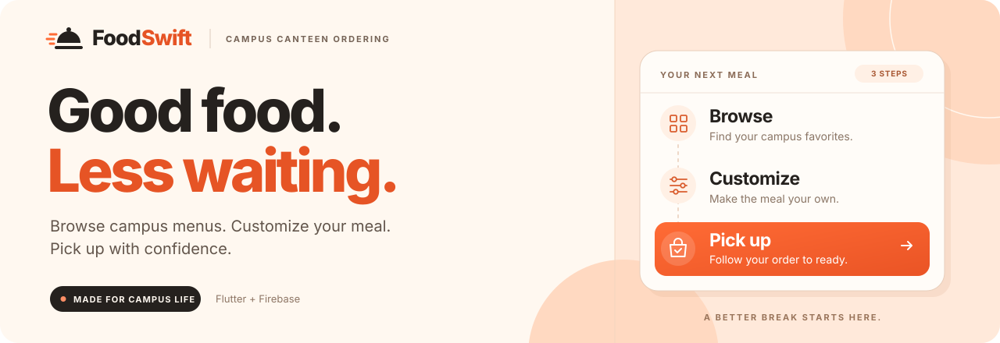
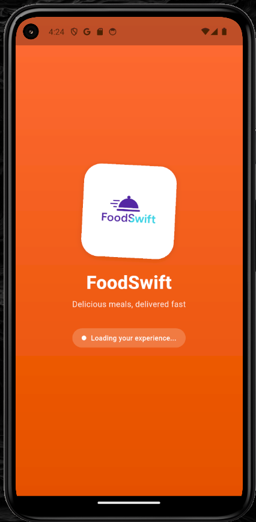
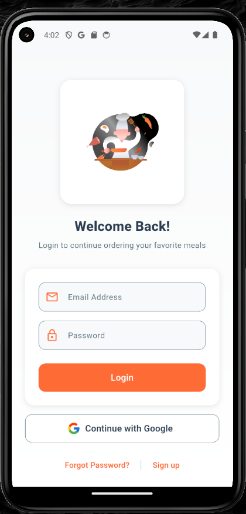
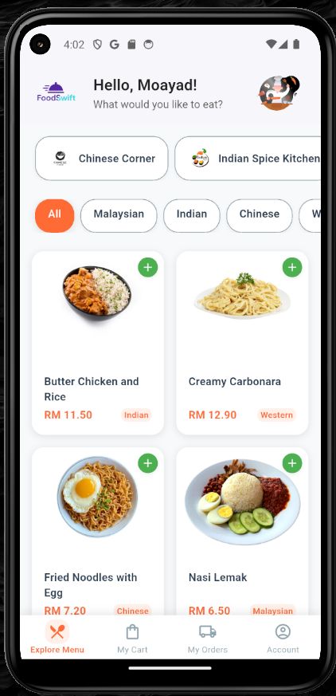
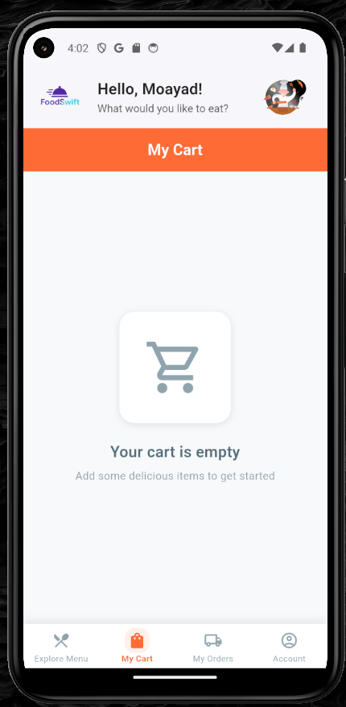
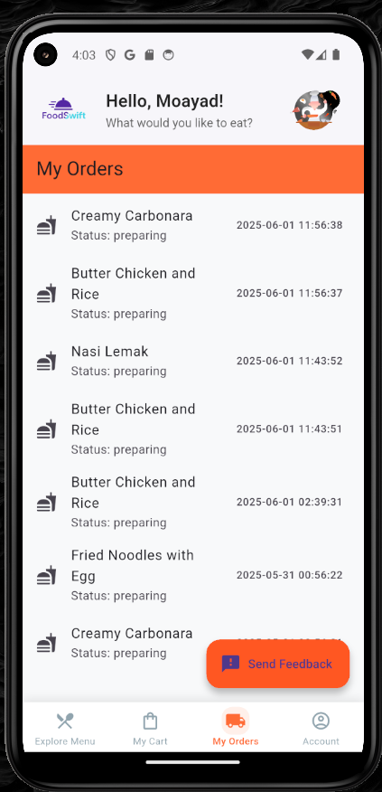
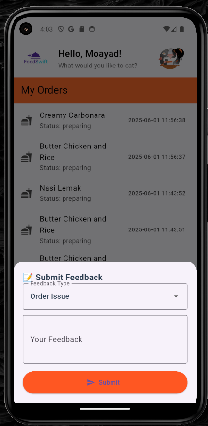
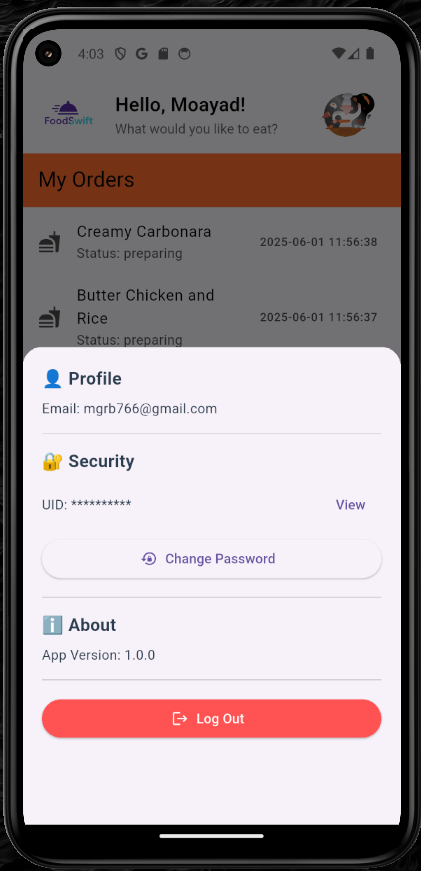
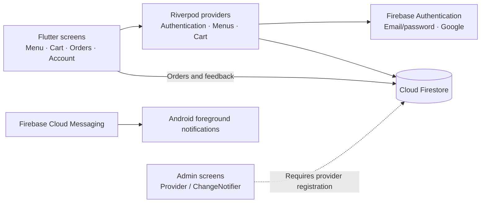

<div align="center">



# FoodSwift

**Your campus canteen, a little closer.**

A Flutter app for browsing campus menus, personalizing meals, and following orders from your phone.

[](https://flutter.dev/)
[](pubspec.yaml)
[](https://firebase.google.com/)
[](lib/features/menu/menu_controller.dart)
[](android/)

[Explore the app](#the-app-in-action) &nbsp; · &nbsp; [Features](#built-around-the-campus-day) &nbsp; · &nbsp; [Architecture](#under-the-hood) &nbsp; · &nbsp; [Get started](#run-it-locally)

</div>

<br />

## A better break between classes

Lunch should fit around your day. FoodSwift brings campus canteens into one mobile experience: discover a dish, choose how you like it, place an order, and check its progress before heading over for pickup.

Built around familiar Malaysian, Indian, Chinese, and Western food categories, the app connects a student ordering experience with Firebase data and a set of administration screens for managing canteen information.

| Discover | Make it yours | Keep up to date |
| :--- | :--- | :--- |
| Browse dishes by canteen and cuisine, with photos and prices in RM. | Choose spice level, portion size, and special notes. | Review your orders and follow status changes through Firestore. |

<br />

## The app in action

Real screenshots from FoodSwift, from the first welcome to the next meal. Select any screen to see it at full size.

<table>
  <tr>
    <td align="center" width="33%">
      <a href="assets/Screenshot_0.png"></a><br />
      <b>01 · Welcome</b><br />
      <sub>An animated introduction to FoodSwift.</sub>
    </td>
    <td align="center" width="33%">
      <a href="assets/Screenshot_1.png"></a><br />
      <b>02 · Sign in</b><br />
      <sub>Email and Google account access.</sub>
    </td>
    <td align="center" width="33%">
      <a href="assets/Screenshot_2.png"></a><br />
      <b>03 · Find your meal</b><br />
      <sub>Canteens, cuisines, and food worth a look.</sub>
    </td>
  </tr>
  <tr>
    <td align="center">
      <a href="assets/Screenshot_3.png"></a><br />
      <b>04 · Your cart</b><br />
      <sub>A dedicated cart screen and empty state.</sub>
    </td>
    <td align="center">
      <a href="assets/Screenshot_4.png"></a><br />
      <b>05 · Follow your order</b><br />
      <sub>Order history and status in one place.</sub>
    </td>
    <td align="center">
      <a href="assets/Screenshot_5.png"></a><br />
      <b>06 · Have your say</b><br />
      <sub>Send feedback without leaving the app.</sub>
    </td>
  </tr>
</table>

<details>
<summary><b>One more look · Account and settings</b></summary>

<p align="center">
  <a href="assets/Screenshot_6.png"></a>
  <br />
  <sub>Profile details, account security, app information, and sign-out.</sub>
</p>

</details>

<br />

## Built around the campus day

| Capability | What is in the project |
| :--- | :--- |
| **Account access** | Email/password registration and sign-in, Google sign-in, password recovery, and password changes. |
| **Campus menus** | Canteen selection, cuisine filtering, dish images, names, and prices. |
| **Meal customization** | Mild, medium, or spicy; small, regular, or large; plus optional preparation notes. |
| **Ordering** | The dish customization screen submits orders to Firestore. Each submitted dish carries its canteen, price, and preparation preferences. |
| **Cart screens** | Cart state, item editing, removal, totals, and submission code are included. The menu-to-cart connection still needs to be completed. |
| **Order updates** | A personal order list backed by a Firestore stream, displaying each dish's stored status and timestamp. |
| **Student feedback** | Categorized feedback for order issues, missing items, app performance, and other concerns. |
| **Administration screens** | Dashboard summaries, user and staff records, menu editing, feedback, complaints, and date-range reports. See the integration notes below before using the admin route. |
| **Visual experience** | Orange accents, rounded food cards, a Lottie cooking animation, and persistent navigation between menu, cart, orders, and account. |

<details>
<summary><b>Current scope and integration notes</b></summary>

FoodSwift is an Android-focused application project. The repository includes the student flow and admin screens; connecting a fresh Firebase project requires the [setup guide](docs/GETTING_STARTED.md).

- **Admin integration:** the dashboard's `AdminProvider` still needs to be registered in the widget tree. Student and admin menu code currently use different collection names (`menu` and `menuItems`).
- **Account profiles:** email registration creates an Auth account but does not create the Firestore user profile required by the email login flow.
- **Notifications:** Android foreground notification handling is present; a backend sender for order updates is not included.
- **Pickup workflow:** scheduled pickup, payment processing, delivery tracking, and a separate staff fulfillment flow are not implemented in this checkout.
- **Verification:** the existing test is Flutter's starter counter test, so it does not establish coverage of the FoodSwift flows.

</details>

<br />

## Under the hood



The app uses a feature-based Flutter layout. Riverpod manages the student-side providers and cart state; several screens write directly to Firestore. The admin module uses a separate `ChangeNotifier` provider. Firebase Authentication handles identity, while Firestore stores the application records.

| Layer | Technology | Purpose |
| :--- | :--- | :--- |
| App | **Flutter + Dart** | Screens, named routes, themes, and Android application. |
| State | **Flutter Riverpod** | Auth controller, menu and canteen loading, and cart state. |
| Admin state | **Provider** | `AdminProvider` and management data. |
| Identity and data | **Firebase Auth + Cloud Firestore** | Accounts, canteens, menus, orders, and feedback. |
| Notifications | **Firebase Messaging + Flutter Local Notifications** | Android foreground notification reception and display. |
| Motion | **Lottie** | Cooking animation used in the welcome and app header experience. |

<br />

## Run it locally

Use a Flutter SDK compatible with **Dart `^3.8.0`**, an Android emulator or device, and your own Firebase project. Android is the platform scaffold included in this repository.

```bash
git clone https://github.com/ALMAFLEHI/FoodSwift.git
cd FoodSwift
flutter pub get
```

Configure Firebase before launching. The project imports `lib/firebase_options.dart`; that file and `android/app/google-services.json` are intentionally excluded from Git. Enable email/password and Google authentication, generate your project's configuration, and prepare the Firestore collections and user profiles.

**[Follow the complete setup guide →](docs/GETTING_STARTED.md)**

Once configuration and data are ready:

```bash
flutter devices
flutter run -d <device-id>
```

<details>
<summary><b>Development commands</b></summary>

```bash
flutter analyze       # Static analysis
flutter test          # Existing starter test; see setup guide for its limitations
flutter build apk     # Android APK build
```

These commands require the local Flutter/Firebase setup. The README does not claim a passing application test suite or a verified release build.

</details>

<br />

## Find your way around

```text
FoodSwift/
├── lib/
│   ├── app/                 # Named routes and shared design tokens
│   ├── features/
│   │   ├── auth/            # Splash, login, and registration
│   │   ├── menu/            # Canteen menu and cuisine filters
│   │   ├── cart/            # Cart state, editing, and checkout
│   │   ├── order/           # Customization and order history
│   │   ├── feedback/        # Student feedback form
│   │   ├── profile/         # Settings and password changes
│   │   └── restaurant/      # Canteen data provider
│   ├── home/                # Main navigation shell
│   ├── models/              # Firestore record models
│   ├── providers/           # Admin state and shared providers
│   ├── screens/             # Admin dashboard
│   └── utils/               # Theme helpers and sample-data generator
├── assets/                  # Original app screenshots, logo, and animation
├── android/                 # Android application scaffold
├── docs/                    # Setup guide and repository artwork
└── test/                    # Starter Flutter widget test
```

## Author and project notes

Created by **[ALMAFLEHI](https://github.com/ALMAFLEHI)** · [Email](mailto:almaflehi0@gmail.com)

For a bug report or an improvement, [open an issue](https://github.com/ALMAFLEHI/FoodSwift/issues). Include the screen involved, steps to reproduce, and any relevant logs.

No license file is currently included. Contact the author regarding reuse or distribution.

<br />

<div align="center">

**FoodSwift** · Made for the moments between classes.

[Back to top ↑](#foodswift)

</div>